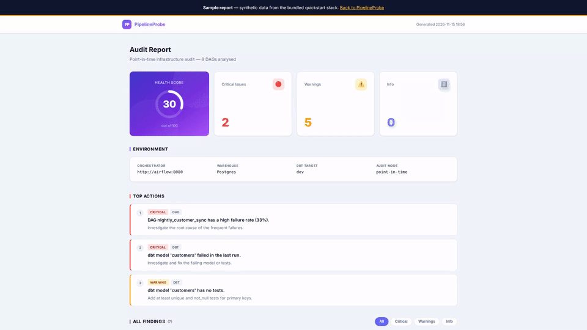

# PipelineProbe

A read-only audit of Airflow, dbt and your warehouse that produces one prioritized report in one command.

[](https://github.com/willowvibe/pipelineprobe/actions/workflows/ci.yml)
[](https://github.com/willowvibe/pipelineprobe/releases)
[](https://opensource.org/licenses/MIT)
[](https://www.python.org/)

[](https://github.com/willowvibe/pipelineprobe/releases/download/v0.3.0/pipelineprobe-demo.mp4)

A narrated demo (the GIF above is a short preview) on synthetic sample data from the bundled quickstart stack. No client or production data.

[Watch the full narrated demo →](https://github.com/willowvibe/pipelineprobe/releases/download/v0.3.0/pipelineprobe-demo.mp4)

## What it does

| Area | What it checks |
|---|---|
| **Airflow** | DAG failure rates, tasks with no retries, stale DAGs |
| **dbt** | Models with zero tests, models whose last run failed |
| **Warehouse** | Postgres: very large tables, tables missing `created_at` / `updated_at`. BigQuery / Snowflake: opt-in cost insights |
| **Report** | 0–100 health score, critical / warning / info counts, severity filter, HTML + JSON |

PipelineProbe makes no SLA findings: Airflow 2.7.1 does not expose task SLA configuration through its API, so the audit deliberately makes no such claim.

## Install

This release is installed from GitHub. The wheel is attached to the v0.3.0 release:

```bash
pip install https://github.com/willowvibe/pipelineprobe/releases/download/v0.3.0/pipelineprobe-0.3.0-py3-none-any.whl
```

Or install the tagged source with [pipx](https://pipx.pypa.io/):

```bash
pipx install git+https://github.com/willowvibe/pipelineprobe@v0.3.0
```

The base install covers Airflow, dbt and Postgres. BigQuery and Snowflake need the optional `cloud` extra, installed from the same release wheel:

```bash
pip install "pipelineprobe[cloud] @ https://github.com/willowvibe/pipelineprobe/releases/download/v0.3.0/pipelineprobe-0.3.0-py3-none-any.whl"
```

Python 3.11 or newer is required.

## Quickstart

The bundled Docker stack runs a real audit against a local Airflow + dbt + Postgres setup. No cloud accounts or existing pipelines are needed.

```bash
cd examples/quickstart
docker compose up --build
```

The first run takes roughly 5–10 minutes (image pulls, build and Airflow startup). The stack runs 8 demo DAGs, and the audit writes real HTML and JSON reports to `examples/quickstart/reports/`. See [examples/quickstart/README.md](examples/quickstart/README.md) for prerequisites, credentials and cleanup.

## What the report shows


- The sample audit scores **30/100** with **2 critical** issues and **5 warnings**.
- Top actions are ordered by severity; each names the exact resource and the recommended fix.
- The severity filter narrows the findings to all, critical, warning or info.

The same report is committed at [site/report/index.html](site/report/index.html) — download it and open it in a browser to click through the filters.

## CI gate and diff

Both commands read `pipelineprobe.yml` from the current directory; `pipelineprobe init` writes a starter file there.

Gate a build on critical findings:

```bash
pipelineprobe audit --fail-on-critical 1
```

This exits non-zero when the critical issue count exceeds the threshold. Use `--fail-on-critical 0` to fail on any critical issue.

Detect regressions between two JSON reports:

```bash
pipelineprobe diff baseline.json report.json
```

`diff` exits `1` on regressions. See [docs/ci-integration.md](docs/ci-integration.md) for GitHub Actions and GitLab CI examples.

## Who this is for

- Data engineers and team leads inheriting a pipeline they did not build.
- Consultants who need a shareable audit artefact without a week of setup.
- Anyone adding a pipeline health gate to CI.

## Need this run against your stack?

WillowVibe runs one-off PipelineProbe audits: point it at your Airflow, dbt and warehouse, get a prioritized report, and walk through the top actions together. See [willowvibe.com](https://www.willowvibe.com).

## Documentation

| Document | Description |
|---|---|
| [Configuration Reference](docs/configuration.md) | All YAML fields, environment variables, and rule-level options |
| [CI Integration Guide](docs/ci-integration.md) | GitHub Actions, GitLab CI, `diff` regression detection |
| [Architecture](docs/architecture.md) | How connectors, rules, and the renderer fit together |
| [Contributing](CONTRIBUTING.md) | Development setup, testing, adding rules and connectors |
| [Changelog](CHANGELOG.md) | Release history |

## Roadmap

- [x] **v0.2.0** — Prefect and Dagster connectors
- [x] **v0.3.0** — Cost insights for BigQuery and Snowflake
- [ ] **v1.0.0** — Data lineage support

## Sample data

The public demo and its report are generated by the bundled quickstart stack. No client or production data is published.

## License

MIT — see [LICENSE](LICENSE) for details.
